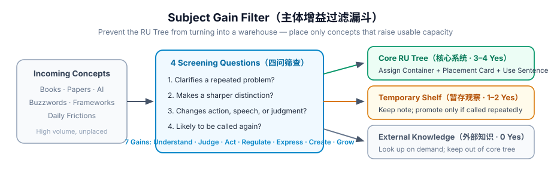

## Opening Problem

What makes a concept worth entering your personal system?

The world offers too many concepts. Some are useful. Some are fashionable. Some are precise but irrelevant. Some sound impressive but do not change how you understand, judge, act, speak, or live.

The first rule of the RU Tree is the **Subject Gain Principle（主体增益原则）**:

> A concept deserves a stable place in the personal tree only if it increases the subject's capacity to understand, judge, act, regulate, express, create, or grow.

The subject（主体） is the living person who reads, thinks, chooses, works, relates, and changes. The tree serves that person.

## Why Filtering Matters

Without a filtering principle, the tree becomes a warehouse（仓库）. Every attractive term enters. Soon the system looks rich but becomes hard to call.

The RU Tree must stay selective. A concept should enter the core tree because it increases usable capacity, not because it is popular, academic, elegant, or difficult.

## Seven Kinds of Gain

### 1. Clearer Understanding

A concept gives clearer understanding when it helps the reader distinguish what was previously vague.

Example: "attention residue（注意力残留）" helps separate ordinary tiredness from the cost of task switching.

### 2. Better Judgment

A concept improves judgment when it changes evaluation.

Example: "opportunity cost（机会成本）" helps the reader judge a choice by what it prevents, not only by what it offers.

### 3. More Effective Action

A concept supports action when it points to a next move.

Example: "single action task（单一行动任务）" helps turn a vague project into one executable step.

### 4. More Stable State

A concept supports regulation when it helps the reader notice, name, and adjust body or mind conditions.

Example: "window of tolerance（耐受窗口）" helps explain why some states cannot be solved by willpower alone.

### 5. Stronger Expression

A concept improves expression when it helps thought become sayable.

Example: "claim（主张）" helps separate an opinion from evidence, support, and counterargument.

### 6. More Continuous Creation

A concept supports creation when it helps ideas move into artifacts, drafts, systems, or repeated practice.

Example: "feedback loop（反馈回路）" helps creation become iterative rather than dramatic.

### 7. Wider Long-Term Capacity

A concept increases capacity when it enlarges what the person can learn, notice, connect, and sustain.

Example: "deliberate practice（刻意练习）" changes skill growth from hope into method.



## Core System and External Knowledge

Not every useful fact belongs in the core tree.

**Core system（核心系统）** concepts are repeatedly useful across life. They shape reading, thinking, action, and self-management.

**External knowledge（外部知识）** may be important inside a narrow domain but does not need to live in the personal core tree.

The boundary is practical:

> If a concept repeatedly changes how I read, decide, act, or explain, it belongs closer to the core system.

## The Four Screening Questions

Before placing a concept, ask:

1. Does this concept help me understand something I repeatedly meet?
2. Does it help me make a better distinction?
3. Does it help me act, speak, or judge differently?
4. Will I likely need to call it again?

If the answer is no, keep the concept as temporary knowledge. It does not need a stable Container yet.

::: {.content-visible when-format="html"}
<div data-ru-toy="ch01-gain-filter"></div>
:::

## Misuse

The Subject Gain Principle can be misused in two ways.

First, the reader may become too narrow and reject everything that is not immediately useful. That weakens imagination. Some concepts need time before their gain appears.

Second, the reader may call everything "useful" and place everything. That destroys the tree.

The balanced rule is:

> Give promising concepts a temporary position. Give repeatedly useful concepts a stable position.

::: {.content-visible when-format="html"}
<div data-ru-toy="ch01-gain-radar"></div>
:::

## Chapter Output

After this chapter, the reader should be able to ask:

```text
Concept:
What gain does it give?
Which repeated problem does it clarify?
What sentence or action does it make possible?
Should it enter the core tree, stay temporary, or remain external?
```

