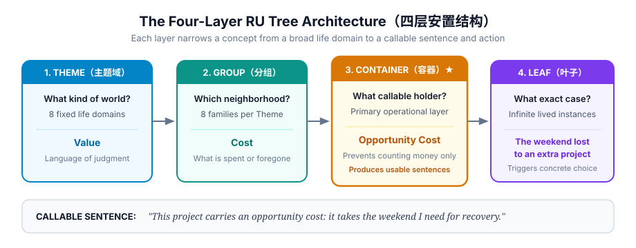

## Opening Problem

How should a concept be placed so that it becomes easy to call?

A concept cannot simply be thrown into a folder. It needs a structure that is broad enough to organize life and specific enough to guide use. The RU Tree uses four layers:

> Theme → Group → Container → Leaf

Each layer answers a different question.

## Theme

**Theme（主题域）** is the largest life domain.

The eight Themes are:

- Body
- Mind
- Language
- Work
- Relationship
- Society
- Technology
- Value

Theme answers:

> What kind of world is this concept talking about?

Body talks about physical conditions. Mind talks about inner processing. Language talks about expression and meaning. Work talks about action and output. Relationship talks about access and trust. Society talks about roles and structures. Technology talks about mediated action. Value talks about judgment.

## Group

**Group（分组）** is a major family inside a Theme.

Example:

Inside Value, the Groups include Importance, Benefit, Cost, Risk, Purpose, Standard, Ethics, and Meaning.

Group answers:

> Which neighborhood does this concept belong to?

Group prevents a Theme from becoming too large and vague.

## Container

**Container（容器）** is the most important layer for use. It is specific enough to hold repeated examples, but broad enough to connect many cases.

Example:

Inside Value → Cost, the Containers include Opportunity Cost, Sunk Cost, and Time Cost.

Container answers:

> What usable holder makes this concept callable?

A good Container has five qualities:

- It is more specific than a Group.
- It is more general than a single example.
- It can hold several concrete cases.
- It creates useful sentences.
- It prevents common misplacement.

Container is where the book does most of its work.

## Leaf

**Leaf（叶子）** is the concrete concept, case, example, quote, task, tool, symptom, or sentence.

Example:

```text
Theme: Value
Group: Cost
Container: Opportunity Cost
Leaf: The weekend I cannot spend resting because I accepted another project.
```

Leaf answers:

> What exact thing am I placing right now?

Leaves are infinite. The book does not try to list them all. It trains the reader to place them.



## Why Four Layers?

One layer is too vague:

> "This is about Value."

Two layers are better but still broad:

> "This is about Value → Cost."

Three layers become usable:

> "This is about Value → Cost → Opportunity Cost."

Four layers connect structure to life:

> "This project has an opportunity cost: it takes the weekend I need for recovery."

The fourth sentence is where reading becomes action.

::: {.content-visible when-format="html"}
<div data-ru-toy="ch03-four-layer-stepper"></div>
:::

## Placement Card

Use this card:

```text
Leaf:
Primary Theme:
Group:
Container:
Associated positions:
Common misplacement:
Use sentence:
Action or judgment it supports:
```

## Example

Concept: "AI workflow."

```text
Primary Theme: Technology
Group: Workflow
Container: AI Workflow
Associated positions: Language → Prompt; Work → Process; Value → Quality Standard
Common misplacement: treating the AI model as the whole workflow
Use sentence: The model is one step; the workflow includes input, review, storage, and use.
Action supported: design the full process instead of only choosing a tool
```

::: {.content-visible when-format="html"}
<div data-ru-toy="ch03-placement-card-studio"></div>
:::

## Common Mistakes

- Placing a Leaf directly under a Theme.
- Treating Group names as if they were enough for action.
- Creating too many Containers that hold only one case.
- Forgetting that Containers should produce language.
- Treating the tree as fixed instead of revisable.

## Chapter Output

After this chapter, the reader should be able to produce a four-layer placement:

```text
This concept belongs first to ___,
inside ___,
under the Container ___,
with this concrete Leaf: ___.
```

