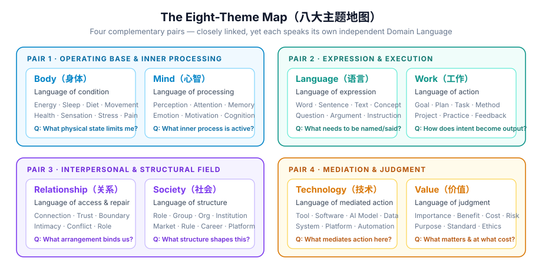

## Opening Problem

What does the whole personal RU Tree look like?

The tree has eight Themes arranged in four pairs:

- Body / Mind
- Language / Work
- Relationship / Society
- Technology / Value

The pairs show strong connections, but each Theme remains independent. Body and Mind influence each other, but they do not speak the same language. Technology and Value constantly meet, but a technical function is not a value judgment.



## The Eight Themes

### Body（身体）

Body is the domain of physical condition: energy, sleep, stress, pain, movement, nutrition, breathing, recovery, and health signals.

Its core question:

> What physical condition is supporting or limiting the system?

### Mind（心智）

Mind is the domain of attention, emotion, memory, belief, motivation, learning, decision, self-narrative, and regulation.

Its core question:

> What inner process is shaping perception, feeling, judgment, and action?

### Language（语言）

Language is the domain of terms, definitions, statements, questions, arguments, narratives, prompts, documents, and instructions.

Its core question:

> What needs to be said, named, clarified, argued, or instructed?

### Work（工作）

Work is the domain of goals, tasks, projects, plans, workflows, feedback, practice, output, and artifacts.

Its core question:

> How does intention become action and result?

### Relationship（关系）

Relationship is the domain of connection, trust, boundary, intimacy, conflict, cooperation, influence, and relational role.

Its core question:

> What is the arrangement between people?

### Society（社会）

Society is the domain of roles, groups, organizations, institutions, markets, rules, careers, and platform ecologies.

Its core question:

> What social structure is shaping this situation?

### Technology（技术）

Technology is the domain of tools, software, AI models, data, systems, platforms, automation, and workflows.

Its core question:

> What technical object mediates action, and where does it sit in the system?

### Value（价值）

Value is the domain of importance, benefit, cost, risk, purpose, standard, ethics, and meaning.

Its core question:

> What matters, according to which standard, at what cost and risk?

::: {.content-visible when-format="html"}
<div data-ru-toy="ch04-eight-theme-explorer"></div>
:::

## How the Themes Work Together

A real situation often crosses several Themes.

Example:

> "I cannot finish this project."

Possible placements:

- Body: low energy or poor sleep.
- Mind: attention fragmentation or fear.
- Language: unclear problem statement.
- Work: no next action or feedback loop.
- Relationship: unclear collaboration role.
- Society: organizational rule or market pressure.
- Technology: tool or workflow failure.
- Value: unclear priority or standard.

The tree does not force one answer. It helps the reader separate the problem into positions.

::: {.content-visible when-format="html"}
<div data-ru-toy="ch04-multi-theme-decomposer"></div>
:::

## Avoiding Encyclopedia Mode

The RU Tree is not trying to list all knowledge. A Theme is not a subject field. A Group is not a textbook chapter. A Container is not a dictionary entry.

The test is always:

> Does this placement help me understand, judge, act, regulate, express, create, or grow?

If not, the structure is becoming decorative.

## Domain Language First

Each Theme teaches a language.

Body teaches the language of condition. Mind teaches the language of processing. Language teaches the language of expression. Work teaches the language of action. Relationship teaches the language of access and repair. Society teaches the language of structure. Technology teaches the language of mediated action. Value teaches the language of judgment.

When the domain language is familiar, reading becomes easier. The reader no longer fights every term. They can follow the causal chain.

## Chapter Output

After this chapter, the reader should be able to ask eight placement questions:

```text
Is this Body?
Is this Mind?
Is this Language?
Is this Work?
Is this Relationship?
Is this Society?
Is this Technology?
Is this Value?
```

The answer may be more than one. But one Theme usually speaks first.

