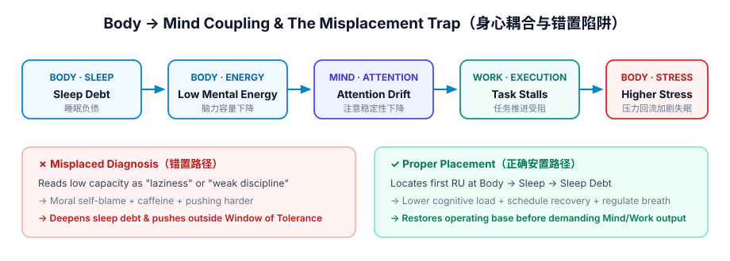

## Opening Problem

Why do I feel unable to think, even when I know what to do?（为什么我明明知道该做什么，却没有能力去想、去做？）

This is the first problem Body helps us name. A person may say, "I am lazy," "I am unfocused," or "I have no discipline." But the real issue may be lower than motivation. It may be sleep debt（睡眠负债）, low mental energy（脑力不足）, chronic stress response（长期压力反应）, physical fatigue（身体疲劳）, dehydration（水分不足）, or a pain signal（疼痛信号） that has been ignored for too long.

Body is the operating base of the personal system.（身体是个人系统的运行底盘。）It is not a medical textbook, and it is not a fitness manual. In this book, Body means the domain language（领域语言） you need in order to notice, name, and regulate the physical conditions that support thinking, work, relationship, learning, and creation.

::: {.callout-note title="Scope & Boundary"}
This chapter helps with naming and placement, not diagnosis or treatment. Sudden, severe, persistent, or worsening symptoms（突发、严重、持续或恶化的症状） call for professional medical judgment.
:::

The sentence "I feel bad today" is too vague to guide action. Body turns it into more usable sentences:

- My mental energy is low because my sleep quality was poor.（我脑力低，因为睡眠质量差。）
- My stress response is activated, so I should regulate before deciding.（我的压力反应被激活，所以做决定前要先调节。）
- This is physical fatigue, not a motivation problem.（这是身体疲劳，不是动机问题。）
- This pain signal is telling me to stop and inspect.（这个疼痛信号在提醒我停下来检查。）

The goal is not to collect body knowledge. The goal is to make body states more readable and more callable（让身体状态更可读、更可调用）.

## Domain Language

Body talks about the world through state, energy, recovery, signal, and limit.（Body 用状态、能量、恢复、信号和限制来谈论世界。）

When Body language is weak, the reader tends to use moral language for physical problems:

- "I am lazy" instead of "my physical energy is low."
- "I am stupid today" instead of "my mental energy is depleted."
- "I am overreacting" instead of "my stress response is activated."
- "I should push through" instead of "this pain signal needs attention."

Body language does not remove responsibility. It makes responsibility more precise. If the problem is sleep debt, the next action is different from the action for a vague lack of discipline. If the problem is dehydration, the answer is not a new productivity system. If the problem is chronic stress, the answer is not simply "try harder."

Body gives the reader a vocabulary for physical causality（身体因果）:

```text
sleep quality → mental energy → attention stability → task execution
（睡眠质量 → 脑力 → 注意稳定性 → 任务执行）

stress response → window of tolerance → conflict behavior
（压力反应 → 耐受窗口 → 冲突行为）

nutrition / hydration → physical state → mood and focus
（营养 / 水分 → 身体状态 → 情绪和专注）
```

Once this language is familiar, the reader can follow arguments about body states without decoding every term. That is the point of this chapter.

## Group Map

Body has eight Groups. They are not eight topics to memorize. They are eight ways the body talks to the rest of the personal system.

| Group | What It Names | Typical Question |
|---|---|---|
| Energy（精力） | available capacity for action and cognition（行动和认知的可用容量） | Do I have the energy this task requires? |
| Sleep（睡眠） | recovery through sleep and sleep rhythm（通过睡眠和节律恢复） | Did I actually recover? |
| Diet（饮食） | energy input and material support（能量输入与身体材料支持） | Is my input supporting my state? |
| Movement（运动） | activity, training, and physical maintenance（活动、训练与身体维护） | Is my body being maintained? |
| Health（健康） | monitoring, prevention, and illness signals（监测、预防与疾病信号） | Is this a state change or a symptom? |
| Sensation（感官） | body signals and sensory thresholds（身体信号与感官阈值） | What is my body telling me? |
| Stress（压力） | stress activation and regulation（压力激活与调节） | Is my system inside or outside its tolerance range? |
| Fatigue & Pain（疲劳与疼痛） | warning signals and recovery needs（警告信号与恢复需求） | Should I continue, recover, or inspect? |

## Core Containers

The following containers are not a complete body encyclopedia. They are stable handles（稳定抓手） for reading body states. Some containers are explained in full; others are kept brief when a smaller handle is enough.

### Energy

Energy talks about capacity, cost, recovery, and pacing. It asks: what can this body do now, what will the action cost, and what kind of recovery does the system need?

#### Physical Energy

**Primary position:** Body → Energy → Physical Energy

Physical Energy is the capacity for physical action: walking, commuting, cleaning, exercising, standing, and doing work that requires the body.

It solves the problem of confusing "I do not want to move" with "my body does not have enough usable energy."（它解决的是把“不想动”和“身体可用能量不足”混在一起的问题。）

It can hold RU such as stamina, vitality, strength level, and endurance capacity.

**Common misplacement:** Physical Energy is often misplaced under Mind → Motivation. The person thinks the problem is desire, when the real problem is capacity. That misplacement leads to self-blame instead of recovery, food, rest, or gradual training.

**Associated positions:** Body → Movement → Exercise; Body → Fatigue & Pain → Physical Fatigue; Value → Cost → Energy Cost.

**Associated language:** restore, deplete, conserve, expend; high, low, stable, fluctuating.

**Use sentences:**

- My physical energy is low today.
- This task has a high physical energy cost.（这个任务的体力成本很高。）
- I need to restore physical energy before I push harder.

#### Mental Energy

**Primary position:** Body → Energy → Mental Energy

Mental Energy is the bodily capacity for cognitive work（认知工作的身体容量）. It holds RU such as focus capacity, cognitive stamina, mental clarity, and decision stamina.

**Common misplacement:** It is often placed too quickly under Mind → Attention. Attention is where resources are directed; Mental Energy is part of the bodily capacity that supplies them.

**Use sentence:** I do not have enough mental energy for complex work right now.

### Sleep

Sleep talks about recovery, rhythm, restoration, and deficit. It asks: did the system actually recover, or did it only spend time in bed?

#### Sleep Quality

**Primary position:** Body → Sleep → Sleep Quality

Sleep Quality names how restorative sleep was（睡眠是否真正恢复了身体和心智）. It is not the same as sleep duration. A person can sleep for eight hours and still wake up unrestored.

It can hold RU such as deep sleep, sleep efficiency, wake after sleep onset, and restorative sleep.

**Common misreading:** Sleep Quality is often reduced to time management. The person asks, "Did I allocate enough hours?" but misses whether the sleep actually restored the system.

**Associated positions:** Mind → Memory → Long-term Memory; Body → Energy → Mental Energy; Mind → Emotion → Emotional Stability.

**Associated language:** improve, track, disrupt, restore; deep, light, fragmented, restorative.

**Use sentences:**

- My sleep quality was poor last night.
- I slept long enough, but the sleep was not restorative.（我睡的时间够了，但没有恢复感。）
- Poor sleep quality may explain my low mental energy today.

#### Sleep Debt

**Primary position:** Body → Sleep → Sleep Debt

Sleep Debt is the recovery deficit that accumulates when actual sleep stays below bodily need.（睡眠负债是实际睡眠长期低于身体需要时积累的恢复赤字。） It holds RU such as recovery need, catch-up sleep, chronic deficit, and sleep restriction.

**Common misreading:** Sleep Debt is often treated as something caffeine or stimulants can solve. Caffeine can mask sleep debt, but it cannot repay it.

**Use sentence:** I have been accumulating sleep debt this week.

### Diet

Diet talks about input, stability, adequacy, and support. It asks: is what enters the body supporting the state the person is trying to maintain?

#### Nutrition

**Primary position:** Body → Diet → Nutrition

Nutrition names the quality of material input: protein, carbohydrate, fat, vitamins, minerals, fiber, and other basic supports.

It solves the problem of making "eating well" too vague. Nutrition helps the reader ask whether food is supporting energy, mood, immunity, and recovery.

It can hold RU such as protein, carbohydrate, fat, vitamin, mineral, and fiber.

**Common misplacement:** Nutrition is often misplaced under Value → Ethics when food is moralized as "good" or "bad." In the Body tree, the first question is functional: does this input support the system?

**Associated positions:** Body → Energy → Physical Energy; Body → Health → Physical State; Value → Benefit → Health Benefit.

**Associated language:** consume, balance, improve, neglect; adequate, deficient, excessive, balanced.

**Use sentences:**

- My nutrition has been poor this week.
- I need more stable nutrition before heavy cognitive work.
- This is a nutrition problem, not only a motivation problem.

#### Hydration

**Primary position:** Body → Diet → Hydration

Hydration is the state of water balance in the body. Mild dehydration（轻度脱水） can affect focus, mood, and physical comfort before the person consciously feels thirsty.

**Common misreading:** Hydration often disappears into a vague "bad state." That makes it easy to overlook a simple physical cause of fatigue or poor focus.

**Use sentence:** Before I diagnose this as a deep problem, I should check hydration.

### Movement

Movement talks about maintenance, training, mobility, and recovery. It asks: is the body being maintained through ordinary activity and appropriate training?

#### Physical Activity

**Primary position:** Body → Movement → Physical Activity

Physical Activity is non-training movement: walking, standing, stairs, household work, and other daily movement.

It solves the problem of treating exercise as the only form of movement. A person may not need an intense program first; they may need less sitting and more daily movement.

It can hold RU such as walking, standing, stair climbing, and household labor.

**Common misplacement:** Physical Activity is often collapsed into Body → Movement → Exercise. This makes the person think the only solution is formal training, while the first intervention may be daily walking.

**Associated positions:** Body → Energy → Physical Energy; Body → Health → Physical State; Technology → Tool → Wearable Device.

**Associated language:** increase, maintain, reduce, track; sedentary, light, moderate, active.

**Use sentences:**

- My physical activity has been low this week.
- I need to increase daily walking before adding intense exercise.
- Low physical activity may be affecting my energy.

#### Exercise

**Primary position:** Body → Movement → Exercise

Exercise is intentional physical training. It holds RU such as strength training, cardio, stretching, HIIT, and yoga.

**Common misreading:** Exercise is often turned into moral proof. In the Body tree, it is first a maintenance and training unit, with intensity, recovery, and progression.

**Use sentence:** Exercise should maintain the system, not break it.

### Health

Health talks about monitoring, prevention, symptoms, and care-seeking. It asks: is this a normal state variation, a signal to monitor, or a symptom that needs outside judgment?

#### Physical State

**Primary position:** Body → Health → Physical State

Physical State is the overall bodily condition as experienced by the person. It is not a diagnosis. It is the structured version of "how my body feels today."

It can hold RU such as wellness, malaise, vitality, and recovery status.

**Common misplacement:** Physical State is often misplaced under Emotion. A poor physical state may create a bad mood, but the primary place may still be Body.

**Associated positions:** Mind → Emotion → Mood; Body → Energy → Mental Energy; Body → Sensation → Body Signal.

**Associated language:** monitor, improve, maintain, detect; good, fair, poor, declining.

**Use sentences:**

- My physical state is not great today.
- I should monitor my physical state before increasing workload.
- This bad mood may be partly a physical state issue.

#### Symptom

**Primary position:** Body → Health → Symptom

Symptom is a describable sign that something may be physically wrong. It turns "I feel off" into something trackable.

**Common misplacement:** Symptom is often collapsed into Body → Sensation → Body Signal. A body signal may be ordinary information; a symptom is a signal with possible health significance.

**Use sentence:** The symptom is mild, but it has been persistent.

### Sensation

Sensation talks about signal, threshold, interpretation, and response. It asks: what information is the body giving, and how clearly can the person detect it?

#### Body Signal

**Primary position:** Body → Sensation → Body Signal

Body Signal is information from the body: hunger, thirst, temperature, heartbeat, breathing, tension, and other felt signals.

It solves the problem of noticing the body only after a signal becomes disruptive. A readable body signal allows earlier adjustment.

It can hold RU such as hunger, thirst, temperature, heartbeat, and breathing.

**Common misplacement:** Body Signal is often misplaced under Mind → Emotion. Some bodily signals are felt emotionally, but their first position may still be sensory and physical.

**Associated positions:** Body → Health → Physical State; Body → Stress → Stress Response; Language → Question → Diagnostic Question.

**Associated language:** sense, ignore, interpret, respond; subtle, clear, urgent, chronic.

**Use sentences:**

- I have been ignoring my body signals this week.
- This body signal means I should pause.
- I need to interpret the signal before I react.

#### Sensory Threshold

**Primary position:** Body → Sensation → Sensory Threshold

Sensory Threshold is the level at which a signal becomes noticeable.（感官阈值是信号变得可感知的门槛。）Fatigue, stress, and attention can raise or lower it.

**Common misreading:** Sensory Threshold is often mistaken for the signal itself. The person says, "The world is louder today," when the threshold may have shifted because of fatigue or stress.

**Use sentence:** The signal may not have changed; my threshold may have changed.

### Stress

Stress talks about demand, activation, regulation, and tolerance range. It asks: is the system responding to pressure in a way that still allows useful action?

#### Stress Response

**Primary position:** Body → Stress → Stress Response

Stress Response is the automatic bodily reaction to demand or threat: heart rate increase, shallow breathing, muscle tension, cortisol release, and alertness shifts.

It solves the problem of treating stress only as a thought or feeling. Stress is also a body state.

It can hold RU such as cortisol release, heart rate increase, muscle tension, and shallow breathing.

**Common misplacement:** Stress Response is often misplaced under Mind → Emotion → Anxiety. Anxiety may be part of the experience, but the body response has its own position and its own regulation path.

**Associated positions:** Mind → Emotion → Negative Emotion; Body → Sensation → Body Signal; Relationship → Conflict → Escalation.

**Associated language:** trigger, regulate, calm, amplify; acute, chronic, proportional, disproportionate.

**Use sentences:**

- This situation is triggering a stress response.
- I need to regulate my stress response before continuing.
- My stress response is real, but it may not be proportional.

#### Window of Tolerance

**Primary position:** Body → Stress → Window of Tolerance

Window of Tolerance is the range in which a person can handle stress effectively. Outside it, the person may move into hyperarousal（过度唤醒） or hypoarousal（过低唤醒）.

**Common misplacement:** Window of Tolerance is often placed under Value → Standard. The person judges themselves for not coping well, instead of noticing that their system is outside its current processing range.

**Use sentence:** When stress pushes me out of my window of tolerance, I need regulation before problem-solving.

### Fatigue & Pain

Fatigue & Pain talks about warning, recovery need, continuation, and inspection. It asks: should the person continue, reduce load, recover, or seek help?

#### Physical Fatigue

**Primary position:** Body → Fatigue & Pain → Physical Fatigue

Physical Fatigue is the recovery need after physical expenditure. It is a normal signal, not a failure of will.

It can hold RU such as exercise-induced fatigue, recovery need, muscle soreness, and overuse.

**Common misplacement:** Physical Fatigue is often misplaced under Work → Productivity. The person sees lower output and tries to optimize workflow, when the body is asking for recovery.

**Associated positions:** Body → Energy → Physical Energy; Body → Movement → Exercise; Value → Cost → Energy Cost.

**Associated language:** accumulate, recover from, ignore, manage; mild, moderate, severe, chronic.

**Use sentences:**

- I am feeling physical fatigue after today's workout.
- I need rest to recover from this fatigue.
- This is a recovery signal, not a productivity failure.

#### Pain Signal

**Primary position:** Body → Fatigue & Pain → Pain Signal

Pain Signal is the warning information carried by pain. It is not the same as the whole medical cause of pain, but it is the signal the person must interpret.

**Common misreading:** Pain Signal is often read in two opposite ways: ignored as "nothing," or inflated into catastrophe. The Body tree helps the reader ask what kind of signal it is and what action it calls for.

**Use sentence:** I should interpret this signal instead of ignoring it.

::: {.content-visible when-format="html"}
<div data-ru-toy="ch05-body-energy-sim"></div>
:::

## Misplacement Patterns

The individual containers above show specific mistakes. The deeper pattern is this: body states often feel like mental, moral, or productivity problems. The table below summarizes the recurring error types.

| Misplaced As | Better Placement | Why It Matters |
|---|---|---|
| laziness（懒） | Body → Energy → Physical Energy / Mental Energy | Low capacity needs recovery or pacing, not only self-blame. |
| poor discipline（自律差） | Body → Sleep → Sleep Debt | Sleep loss can weaken attention and impulse control. |
| anxiety only（只是焦虑） | Body → Stress → Stress Response | Regulation may need breath, movement, rest, or environmental change. |
| productivity problem（效率问题） | Body → Fatigue & Pain → Physical Fatigue | Workflow cannot replace recovery. |
| vague bad mood（模糊坏心情） | Body → Health → Physical State | Mood may be partly driven by bodily state. |
| overreaction（反应过度） | Body → Stress → Window of Tolerance | The system may be outside its current processing range. |

The point is not to reduce everything to the body. The point is to stop skipping the body when the body is part of the causal chain.



## Causal Chain

Here is a common Body chain:

```text
sleep debt
→ lower mental energy
→ unstable attention
→ weaker task execution
→ more stress
→ worse sleep

（睡眠负债 → 脑力下降 → 注意不稳 → 任务执行变弱 → 压力增加 → 睡眠更差）
```

This chain shows why Body is not a side topic. A small body deficit can become a work problem, a mind problem, a relationship problem, and eventually a value problem if the person starts judging the whole self through one depleted state.

The useful move is to place the first RU correctly. If the first RU is Sleep Debt, the system should not start with "I need a better personality." It should start with recovery, schedule repair, and reduced cognitive load.

::: {.content-visible when-format="html"}
<div data-ru-toy="ch05-body-misplacement-lab"></div>
:::

## Placement Practice

Place each RU. Give a primary position, one associated position, and one use sentence.

1. caffeine crash
2. neck pain
3. low morning energy
4. shallow breathing
5. noise sensitivity

Example:

```text
RU: shallow breathing
Primary position: Body → Stress → Stress Response
Associated position: Body → Sensation → Body Signal
Use sentence: My shallow breathing may mean my stress response is activated.（呼吸变浅可能说明我的压力反应被激活。）
```

Possible placements:

| RU | Primary Position | Associated Position | Use Sentence |
|---|---|---|---|
| caffeine crash | Body → Energy → Mental Energy | Body → Sleep → Sleep Debt | My afternoon crash may be masked sleep debt, not a lack of discipline. |
| neck pain | Body → Fatigue & Pain → Pain Signal | Body → Health → Symptom | This neck pain is a signal I should interpret, not ignore. |
| low morning energy | Body → Energy → Physical Energy / Mental Energy | Body → Sleep → Sleep Quality | My low morning energy may come from poor sleep quality. |
| shallow breathing | Body → Stress → Stress Response | Body → Sensation → Body Signal | My shallow breathing may mean my stress response is activated. |
| noise sensitivity | Body → Sensation → Sensory Threshold | Body → Fatigue & Pain → Physical Fatigue | My noise sensitivity may mean my sensory threshold is lower today. |

## Chapter Output

After this chapter, the reader should have a Body language that can turn vague state judgments into placed concepts:

```text
"I feel bad"
→ Sleep Debt / Mental Energy / Stress Response / Physical Fatigue / Pain Signal
→ clearer action
```

Body is not the whole system. But it is often the first layer to inspect, because every other Theme runs through a body.
