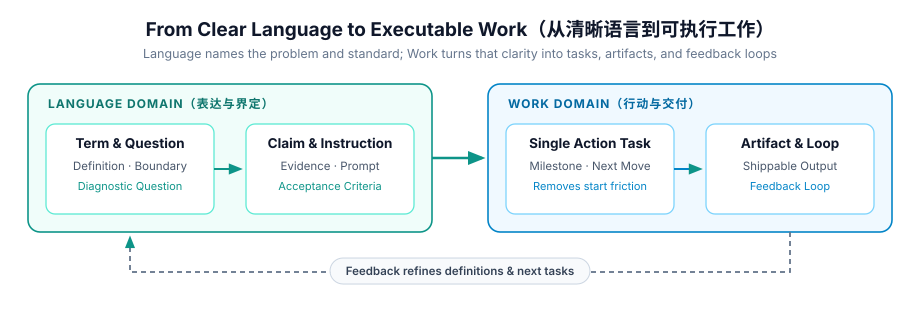

## Opening Problem

Why can I understand something vaguely but fail to say it clearly?（为什么我模糊地懂了，却说不清楚？）

Language is the interface between the inner system and the outside world. It is how thought becomes visible, shareable, testable, and executable. Without language, many mental events stay private and vague. With better language, a vague thought can become a term, a statement, a question, an argument, a narrative, or an instruction.

When Language is weak, a person says:

- "This feature has a problem."
- "I kind of understand it."
- "The AI did not give me what I wanted."
- "We are not aligned."

These sentences may be true, but they are not yet useful. Language turns them into clearer units:

- This feature exceeds the response-time criterion.（这个功能超过了响应时间标准。）
- I understand the term, but I cannot define the concept boundary.（我懂这个术语，但说不清概念边界。）
- My prompt lacks context, constraints, and output format.（我的提示词缺少上下文、约束和输出格式。）
- We have different claims about the same problem.（我们对同一个问题有不同主张。）

The goal of this chapter is not eloquence（文采）. It is placement. Language gives concepts a form that can be called, tested, revised, and acted on.

::: {.callout-note title="Scope & Boundary"}
This chapter is not a grammar manual, rhetoric course, or vocabulary list. It focuses on language as a concept interface（概念接口）: naming, distinguishing, questioning, arguing, narrating, and instructing.
:::

## Domain Language

Language talks about the world through naming, statement, structure, definition, question, argument, narrative, and instruction. It asks:

- What is this called?
- What exactly am I saying?
- What kind of sentence is this?
- What question am I asking?
- What claim am I making?
- What story am I using?
- What action should this language produce?

Language is central to this book because RU placement depends on language. A concept is not fully placed until the reader can say it, write it, question it, and use it in a sentence.

Language gives the reader a vocabulary for expressive causality（表达因果）:

```text
vague term → vague definition → vague question → weak answer
（术语模糊 → 定义模糊 → 问题模糊 → 答案变弱）

unclear claim → weak evidence → unstable argument
（主张不清 → 证据弱 → 论证不稳定）

vague prompt → noisy output → poor workflow
（提示词模糊 → 输出噪声大 → 工作流变差）
```

Once this language is familiar, the reader can read, write, ask, argue, and instruct without stopping at every unclear unit.

## Group Map

Language has eight Groups. They are eight ways language makes the world usable.

| Group | What It Names | Typical Question |
|---|---|---|
| Word & Phrase（词与短语） | naming units and short expressions（命名单元与短表达） | What should this be called? |
| Sentence（句子） | units of judgment or action（判断或行动单位） | What exactly does this sentence do? |
| Text（文本） | structured written or spoken wholes（结构化文本整体） | How is this expression organized? |
| Concept（概念） | definitions, boundaries, and relations（定义、边界和关系） | What does this concept include and exclude? |
| Question（问题） | inquiry structures（提问结构） | What kind of answer does this question seek? |
| Argument（论证） | claim plus support（主张与支持） | What is being claimed, and why should anyone accept it? |
| Narrative（叙事） | meaning through story and frame（通过故事和框架产生意义） | What story makes this event intelligible? |
| Instruction（指令） | language that makes action happen（让行动发生的语言） | What should the receiver do next? |

## Core Containers

The following containers are not a complete language curriculum. They are the handles most needed for turning vague expression into callable language.

### Word & Phrase

Word & Phrase talks about naming, compression, retrieval, and shared reference. It asks: can this concept be named precisely enough to be called later?

#### Term

**Primary position:** Language → Word & Phrase → Term

Term is a word or phrase that precisely names a concept. A good term compresses a longer explanation into a stable handle.

It solves the problem of repeating long explanations every time the concept appears. Once "RU" is defined, it can carry a whole concept efficiently.

It can hold RU such as RU, Theme, Container, Subject Gain Principle, and domain language.

**Common misplacement:** Term is often misplaced under Concept → Definition. A term names; a definition explains the boundary of what is named.

**Associated positions:** Language → Concept → Definition; Mind → Memory → Retrieval Cue; Society → Group → Jargon Community.

**Associated language:** define, adopt, borrow, clarify; precise, vague, accepted, disputed.

**Use sentences:**

- This term captures a concept I have been trying to name.
- Using the right term reduces the need for long explanation.
- I know the word, but I do not yet know the term.

#### Label

**Primary position:** Language → Word & Phrase → Label

Label is a light classification tag. It holds RU such as tag, category, status, and priority label.

**Common misreading:** A label is often treated as a definition. A label helps retrieval and navigation; it does not explain the concept.

**Use sentence:** A label is not a definition, but it helps with retrieval.

### Sentence

Sentence talks about judgment, action, definition, and classification. It asks: what function does this sentence perform?

#### Statement

**Primary position:** Language → Sentence → Statement

Statement is a sentence that makes a judgment about something. It turns a vague feeling into something that can be tested, qualified, or challenged.

It solves the problem of hiding claims inside feelings. "I feel uneasy" may be real, but "This plan has an unpriced risk" is a clearer statement.

It can hold RU such as assertion, observation, conclusion, and hypothesis.

**Common misplacement:** Statement is often misplaced under Argument → Claim. A claim is a statement inside an argument; not every statement is yet an argued claim.

**Associated positions:** Language → Argument → Claim; Mind → Cognition → Judgment; Value → Risk → Failure Risk.

**Associated language:** make, verify, challenge, qualify; true, false, partial, unverified.

**Use sentences:**

- Can you turn that feeling into a clear statement?
- This statement needs evidence.
- The statement is too broad to be useful.

#### Action Sentence

**Primary position:** Language → Sentence → Action Sentence

Action Sentence is a sentence that names a concrete action. It holds RU such as request, call to action, command, and single-step instruction.

**Common misreading:** Action Sentence is often confused with a goal. A goal points to a desired state; an action sentence tells someone what to do next.

**Use sentence:** "Write 500 words before noon" is clearer than "make progress."

### Text

Text talks about structure, sequence, context, and reuse. It asks: how are sentences organized into a usable whole?

#### Document

**Primary position:** Language → Text → Document

Document is a structured text that records information, rules, processes, or decisions for reuse.

It solves the problem of keeping knowledge inside one person's head. A document turns personal understanding into a shared artifact.

It can hold RU such as manual, specification, guide, contract, reference, and design doc.

**Common misplacement:** Document is often misplaced under Work → Project Artifact. It may be a project artifact, but its language function is to preserve and transmit structured meaning.

**Associated positions:** Work → Project → Project Artifact; Technology → System → Documentation; Society → Organization → Procedure.

**Associated language:** create, update, reference, archive; current, outdated, complete, minimal.

**Use sentences:**

- I need to document this process.
- A good document reduces repeated explanations.
- The document is outdated, so the workflow keeps drifting.

### Concept

Concept talks about definition, boundary, relation, and hierarchy. It asks: what does this unit mean, and where does its meaning stop?

#### Definition

**Primary position:** Language → Concept → Definition

Definition is a boundary statement for a concept. It tells the reader what something is and what it is not.

It solves the problem of using a concept before knowing its edges. A concept without a definition cannot be reliably called.

It can hold RU such as formal definition, working definition, operational definition, and boundary condition.

**Common misplacement:** Definition is often misplaced under Word & Phrase → Term. The term names; the definition sets the boundary.

**Associated positions:** Mind → Cognition → Mental Model; Language → Word & Phrase → Term; Value → Standard → Acceptance Criteria.

**Associated language:** define, refine, challenge, apply; precise, vague, formal, operational.

**Use sentences:**

- I need a clearer definition of this concept.
- A good definition tells me what the concept includes and excludes.
- Without a definition, this term is only a label.

#### Core Concept

**Primary position:** Language → Concept → Core Concept

Core Concept is a foundational idea inside a domain. It holds RU such as first principle, key idea, central thesis, and foundational concept.

**Common misreading:** A core concept is often treated as a buzzword. It becomes core only when it explains many other units in the domain.

**Use sentence:** Once I grasp the core concept, the rest of the domain becomes easier to read.

### Question

Question talks about diagnosis, exploration, clarification, and answer type. It asks: what kind of answer is this language trying to produce?

#### Diagnostic Question

**Primary position:** Language → Question → Diagnostic Question

Diagnostic Question is a question used to identify the current state, cause, or failure point.

It solves the problem of asking broad questions when the situation needs narrowing. "Why is this bad?" is weaker than "What changed before the failure appeared?"

It can hold RU such as what question, where question, why question, how question, and root-cause question.

**Common misplacement:** Diagnostic Question is often misplaced under Work → Problem. It serves problem-solving, but its primary function is linguistic: it shapes what can be found.

**Associated positions:** Work → Problem → Root Problem; Body → Health → Symptom; Mind → Cognition → Mental Model.

**Associated language:** ask, refine, sequence, answer; narrow, broad, leading, useful.

**Use sentences:**

- The diagnostic question should be: what changed?
- A good diagnostic question narrows possible causes.
- This question is too broad to diagnose anything.

#### Clarifying Question

**Primary position:** Language → Question → Clarifying Question

Clarifying Question removes ambiguity and checks shared understanding. It holds RU such as paraphrase check, specificity question, confirmation question, and definition check.

**Common misreading:** Clarifying questions are often treated as interruptions. In complex work and relationships, they prevent expensive misunderstanding.

**Use sentence:** Let me ask a clarifying question before I respond.

### Argument

Argument talks about claim, support, evidence, counterargument, and testability. It asks: what is being asserted, and why should it be accepted?

#### Claim

**Primary position:** Language → Argument → Claim

Claim is the statement an argument tries to support. Without a claim, there is no argument; there is only information.

It solves the problem of confusing facts, feelings, and conclusions. A claim must be inspectable.

It can hold RU such as main claim, sub-claim, implicit claim, and rebuttal.

**Common misplacement:** Claim is often misplaced under Sentence → Statement. A claim is a statement with argumentative pressure: it asks to be supported.

**Associated positions:** Mind → Cognition → Judgment; Value → Standard → Evidence Standard; Language → Sentence → Statement.

**Associated language:** state, support, defend, withdraw; strong, weak, controversial, accepted.

**Use sentences:**

- What is the main claim of this argument?
- This claim needs stronger evidence.
- You gave information, but I cannot find the claim.

#### Evidence

**Primary position:** Language → Argument → Evidence

Evidence is information used to support or challenge a claim. It holds RU such as data point, case study, source reference, empirical finding, and anecdote.

**Common misreading:** Evidence is often confused with confidence. Feeling certain is not evidence.

**Use sentence:** Where is the evidence for this claim?

#### Counterargument

**Primary position:** Language → Argument → Counterargument

Counterargument is a serious challenge to a claim. It holds RU such as objection, opposing view, alternative explanation, and rebuttal.

**Common misreading:** Counterargument is often treated as hostility. In strong thinking, it is a test of whether the claim can survive pressure.

**Use sentence:** The best way to test this argument is to find the strongest counterargument.

### Narrative

Narrative talks about story, frame, event, meaning, and audience. It asks: what story makes this event intelligible?

#### Personal Narrative

**Primary position:** Language → Narrative → Personal Narrative

Personal Narrative is the language form of a person's story about their experience and identity.

It solves the problem of treating experience as raw fact. Experience becomes actionable meaning through narrative.

It can hold RU such as life story, turning point, identity narrative, and origin story.

**Common misplacement:** Personal Narrative is often misplaced under Mind → Self → Self-narrative. Mind holds the inner self-story; Language holds the expressed narrative form.

**Associated positions:** Mind → Self → Self-narrative; Relationship → Connection → Bond; Society → Role → Public Identity.

**Associated language:** tell, shape, rewrite, share; limiting, empowering, fixed, evolving.

**Use sentences:**

- My personal narrative shapes how I interpret events.
- I can tell a different story about this failure.
- This narrative is limiting what I think is possible.

### Instruction

Instruction talks about command, constraint, procedure, prompt, and execution. It asks: what should the receiver do next?

#### Prompt

**Primary position:** Language → Instruction → Prompt

Prompt is an instruction given to AI or another language-processing agent. It translates a need into executable language.

It solves the problem of expecting good output from vague input. A good prompt gives context, constraints, and expected output format.

It can hold RU such as system prompt, user prompt, prompt template, prompt chain, and output format.

**Common misplacement:** Prompt is often misplaced under Technology → AI Model. The model executes, but the prompt is primarily a language unit.

**Associated positions:** Technology → AI Model → Language Model; Work → Workflow → AI Workflow; Language → Instruction → Instruction Template.

**Associated language:** write, refine, test, constrain; vague, precise, short, detailed.

**Use sentences:**

- This prompt needs clearer constraints.
- A good prompt includes context, constraints, and expected output format.
- Prompt quality is language quality, not only tool skill.

#### Instruction Template

**Primary position:** Language → Instruction → Instruction Template

Instruction Template is a reusable instruction pattern. It holds RU such as prompt pattern, standard instruction, reusable directive, and instruction format.

**Common misreading:** A template is often treated as a shortcut. A good template is not a shortcut around thinking; it preserves thinking that has already been clarified.

**Use sentence:** A good instruction template prevents me from forgetting key requirements.

::: {.content-visible when-format="html"}
<div data-ru-toy="ch07-claim-evidence-lab"></div>
:::

## Misplacement Patterns

Language concepts are often misplaced because expression feels like thought, and wording feels like meaning.

| Misplaced As | Better Placement | Why It Matters |
|---|---|---|
| "I know the word" | Language → Concept → Definition | Knowing a word is not the same as knowing its boundary. |
| "This is just a sentence" | Language → Sentence → Statement | A sentence may carry a judgment that needs evidence. |
| "I asked a question" | Language → Question → Diagnostic Question / Clarifying Question | The type of question determines the type of answer. |
| "This is a fact" | Language → Argument → Claim | Many "facts" in conversation are unsupported claims. |
| "The AI is bad" | Language → Instruction → Prompt | Weak output may come from vague instruction. |
| "This is my story" | Language → Narrative → Personal Narrative | A story can organize meaning without being the only possible frame. |

The point is not to reduce thought to language. The point is to notice when unclear language is making thought, work, or relationship harder than necessary.



## Causal Chain

Here is a common Language chain:

```text
vague term
→ unclear definition
→ weak question
→ noisy answer
→ poor action

（术语模糊 → 定义不清 → 问题变弱 → 答案噪声大 → 行动变差）
```

The useful move is to place the first RU correctly. If the first RU is Term, the system should not start with "I need more information." It should start with naming, defining, and checking whether everyone is using the same language.

::: {.content-visible when-format="html"}
<div data-ru-toy="ch07-prompt-precision-lab"></div>
:::

## Placement Practice

Place each RU. Give a primary position, one associated position, and one use sentence.

1. acceptance criteria
2. vague prompt
3. "this is obviously true"
4. personal origin story
5. "what changed before the bug appeared?"

Example:

```text
RU: vague prompt
Primary position: Language → Instruction → Prompt
Associated position: Technology → AI Model → Language Model
Use sentence: The output is weak because my prompt did not specify context or constraints.（输出弱，是因为我的提示词没有说明上下文或约束。）
```

Possible placements:

| RU | Primary Position | Associated Position | Use Sentence |
|---|---|---|---|
| acceptance criteria | Language → Concept → Definition | Value → Standard → Acceptance Criteria | We need a clearer definition of what counts as done. |
| vague prompt | Language → Instruction → Prompt | Technology → AI Model → Language Model | My prompt is too vague for the output I want. |
| "this is obviously true" | Language → Argument → Claim | Mind → Cognition → Cognitive Bias | This claim feels obvious, but it still needs support. |
| personal origin story | Language → Narrative → Personal Narrative | Mind → Self → Self-narrative | My origin story shapes what I think I am allowed to become. |
| "what changed before the bug appeared?" | Language → Question → Diagnostic Question | Work → Problem → Root Problem | This diagnostic question narrows the search space. |

## Chapter Output

After this chapter, the reader should have a Language map that can turn vague expression into placed language units:

```text
"I can't say it clearly"
→ Term / Definition / Statement / Diagnostic Question / Claim / Prompt
→ clearer expression and better action
```

Language is not decoration. It is how concepts become usable in thought, work, relationships, and technology.
