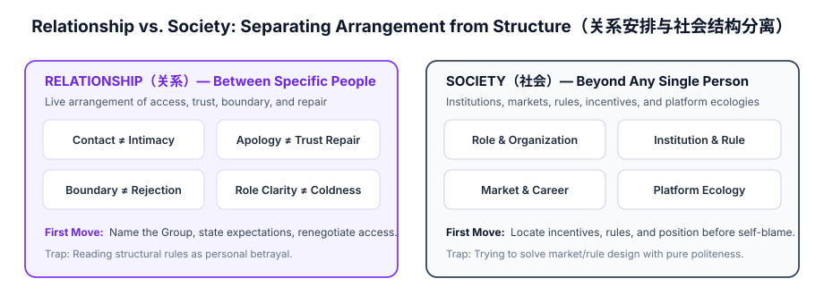

## Opening Problem

Why do relationships become confusing even when everyone seems reasonable?

A relationship is not only a feeling. It is a live arrangement（正在运行的安排） between people: who can ask for what, what can be trusted, where the boundary is, how conflict is repaired, and what role each person is playing.

When the domain language is unclear, the reader often treats every relational problem as a personality problem（人格问题）. Someone is “too sensitive,” “cold,” “selfish,” or “difficult.” Sometimes that may be partly true. But very often the real problem is placement: a trust problem is read as an intimacy problem, a boundary problem is read as a love problem, or a role problem is read as a moral failure.

This chapter gives Relationship a usable language.

::: {.callout-note title="Scope & Boundary"}
Relationship in this book is not therapy, legal advice, or a guide to staying in unsafe relationships. If a relationship includes violence, coercion（胁迫）, stalking, severe manipulation, or serious safety risk, the first task is protection and outside support.

Here, Relationship means the everyday structure through which people connect, coordinate, influence, repair, separate, and remain intelligible（可被理解） to each other.
:::

## Domain Language

Relationship talks about the world through these questions:

- **Access**: Who has access to my time, attention, body, information, or emotional energy?
- **Expectation**: What does each person assume the other person will do?
- **Trust**: What can be relied on?
- **Boundary**: What must not be crossed?
- **Repair**: What happens after damage?
- **Role**: What position is each person occupying in this relationship?
- **Mutuality**: Is the exchange one-sided or reciprocal（互惠的）?
- **Distance**: How close or far should this relationship be?

The key shift is simple: do not ask only “What kind of person is this?” Ask, “What relational position is being activated?”

## Group Map

Relationship has eight major Groups:

1. **Connection（连接）**: contact, recognition, and the beginning of relational presence.
2. **Trust（信任）**: reliability, repair, and the ability to depend on someone.
3. **Boundary（边界）**: limits around body, time, emotion, information, and responsibility.
4. **Intimacy（亲密）**: closeness that involves vulnerability（脆弱性） and selective access.
5. **Cooperation（合作）**: shared action between people.
6. **Conflict（冲突）**: disagreement, friction, harm, and repair.
7. **Influence（影响）**: persuasion, example, pressure, and social proof.
8. **Relational Role（关系角色）**: mentor, peer, partner, friend, family member, colleague, stranger.

| Group | What It Names |
|---|---|
| **Connection（连接）** | contact, recognition, and the beginning of relational presence. |
| **Trust（信任）** | reliability, repair, and the ability to depend on someone. |
| **Boundary（边界）** | limits around body, time, emotion, information, and responsibility. |
| **Intimacy（亲密）** | closeness that involves vulnerability（脆弱性） and selective access. |
| **Cooperation（合作）** | shared action between people. |
| **Conflict（冲突）** | disagreement, friction, harm, and repair. |
| **Influence（影响）** | persuasion, example, pressure, and social proof. |
| **Relational Role（关系角色）** | mentor, peer, partner, friend, family member, colleague, stranger. |

These Groups prevent a relationship from becoming one large emotional fog. Each Group names a different kind of relational work.

## Core Containers

### Connection

Connection is the language of becoming present to another person. It asks whether two people have a channel, a rhythm, and enough recognition to matter to each other at all.

Connection should stay modest（保持适度）. It opens a relational possibility, but it does not by itself create trust, duty, intimacy, or commitment.

#### Contact（接触）

**Primary position:** Relationship → Connection → Contact

**Contact（接触）** names the moment or channel through which two people become available to each other. Contact can be physical, conversational, digital, professional, or emotional. Its primary position is Relationship → Connection.

**Common misplacement:** treating contact as intimacy. A message, meeting, or shared interest may create contact, but it does not automatically create trust, duty, or closeness.

**Use sentence:** “We have contact, but we do not yet have enough trust or shared context.”

#### Bond（联结）

**Primary position:** Relationship → Connection → Bond

**Bond（联结）** names a repeated pattern of meaningful connection. A bond is stronger than contact because it carries memory, recognition, and some expectation of continuity（连续性）.

**Common misreading:** thinking every bond must become deeper. Some bonds are light, situational, and still real.

**Use sentence:** “This is a real bond, but it may not need to become an intimate relationship.”

### Trust

Trust is the language of reliance（可依赖性）. It asks what can be counted on, what evidence supports that reliance, and what must happen when reliance has been damaged.

Trust is often confused with liking. Liking may make trust easier, but trust depends on repeated behavior, not only positive feeling.

#### Reliability（可靠性）

**Primary position:** Relationship → Trust → Reliability

**Reliability（可靠性）** means that a person, process, or relationship behaves consistently enough to be depended on. Reliability is not the same as emotional warmth.

**Common misplacement:** placing reliability under Value as “goodness.” A person may be kind but unreliable, or reliable but emotionally distant.

**Use sentence:** “The issue is not whether they care; the issue is whether this behavior is reliable.”

#### Trust Repair（信任修复）

**Primary position:** Relationship → Trust → Trust Repair

**Trust Repair（信任修复）** names the process after trust has been damaged. Repair requires recognition, responsibility, changed behavior, and time.

**Common misreading:** treating apology as repair. An apology can open repair, but it does not complete repair.

**Use sentence:** “The apology happened, but trust repair still needs evidence.”

### Boundary

Boundary is the language of access and limit. It asks what may enter, what must stay outside, what belongs to the self, and what requires consent or negotiation.

Boundary does not make a relationship less real. It often makes the relationship more readable because people know where responsibility and access begin and end.

#### Personal Boundary（个人边界）

**Primary position:** Relationship → Boundary → Personal Boundary

**Personal Boundary（个人边界）** marks what belongs to the self: body, attention, privacy, choices, and responsibility.

**Common misplacement:** reading boundary as rejection. A boundary may protect a relationship by making the terms clear.

**Use sentence:** “This is not rejection; it is a boundary about what I can offer.”

#### Emotional Boundary（情感边界）

**Primary position:** Relationship → Boundary → Emotional Boundary

**Emotional Boundary（情感边界）** separates empathy from emotional takeover（情绪接管）. It lets a person care without becoming responsible for another person’s entire state.

**Common misreading:** confusing emotional boundary with coldness.

**Use sentence:** “I can care about their pain without making it my job to regulate all of it.”

#### Time Boundary（时间边界）

**Primary position:** Relationship → Boundary → Time Boundary

**Time Boundary（时间边界）** limits when and how long relational access is available.

**Common misplacement:** treating time boundary as a productivity problem only. It is often a relationship problem because it defines access.

**Use sentence:** “The conflict is about time access, not only scheduling.”

### Intimacy

Intimacy is the language of selective closeness. It asks what kind of access is being shared: emotional, physical, intellectual, practical, or narrative.

Intimacy needs boundary. Without boundary, closeness can become confusion, pressure, or dependence instead of chosen access.

#### Emotional Intimacy（情感亲密）

**Primary position:** Relationship → Intimacy → Emotional Intimacy

**Emotional Intimacy（情感亲密）** is closeness through shared feeling, vulnerability, and emotional recognition.

**Common misplacement:** treating emotional intensity as intimacy. Intensity can come from anxiety, conflict, novelty, or dependence.

**Use sentence:** “This feels intense, but intensity is not the same as intimacy.”

#### Physical Intimacy（身体亲密）

**Primary position:** Relationship → Intimacy → Physical Intimacy

**Physical Intimacy（身体亲密）** involves bodily closeness and consent（同意）. Its primary position is Relationship, with strong links to Body and Boundary.

**Common misreading:** assuming physical closeness automatically creates trust or commitment.

**Use sentence:** “Physical intimacy changes access, but it does not replace explicit relational agreement.”

#### Intellectual Intimacy（智力亲密）

**Primary position:** Relationship → Intimacy → Intellectual Intimacy

**Intellectual Intimacy（智力亲密）** is closeness through shared thinking, curiosity, and conceptual recognition.

**Common misplacement:** confusing intellectual intimacy with total compatibility（完全合拍）.

**Use sentence:** “We think well together, but that does not answer every relational question.”

### Cooperation

Cooperation is the language of shared action. It asks what people are trying to do together, how responsibilities are divided, and how coordination turns separate effort into a shared result.

Cooperation is not the same as closeness. Some relationships are healthy because they cooperate well without pretending to be intimate.

#### Teamwork（团队协作）

**Primary position:** Relationship → Cooperation → Teamwork

**Teamwork（团队协作）** is coordinated effort toward a shared task.

**Common misplacement:** treating teamwork as friendship. People can cooperate well without emotional closeness.

**Use sentence:** “This relationship is strong as teamwork, but not necessarily as intimacy.”

#### Coordination（协调）

**Primary position:** Relationship → Cooperation → Coordination

**Coordination（协调）** means aligning timing, responsibilities, handoffs, and expectations.

**Common misreading:** calling a coordination failure a character flaw too quickly.

**Use sentence:** “The frustration may come from missing coordination, not bad intention.”

#### Collaboration（协创）

**Primary position:** Relationship → Cooperation → Collaboration

**Collaboration（协创）** is cooperation that also produces shared design, judgment, or meaning.

**Common misplacement:** placing collaboration under Work only. Collaboration is Work + Relationship: output depends on the relational system.

**Use sentence:** “The work improved because the collaboration pattern improved.”

### Conflict

Conflict is the language of friction, disagreement, rupture（破裂）, and repair. It asks what was harmed, what was misunderstood, what changed, and what arrangement can now work.

Conflict is not automatically failure. Some conflict reveals hidden expectations and makes a clearer relationship possible.

#### Conflict Resolution（冲突解决）

**Primary position:** Relationship → Conflict → Conflict Resolution

**Conflict Resolution（冲突解决）** is the process of moving from disagreement or harm toward a workable next arrangement.

**Common misreading:** thinking resolution means emotional comfort. Sometimes resolution means a clear boundary, a changed role, or a respectful distance.

**Use sentence:** “A good resolution may reduce confusion even if it does not restore closeness.”

#### Misunderstanding（误解）

**Primary position:** Relationship → Conflict → Misunderstanding

**Misunderstanding（误解）** is a gap between intended meaning and received meaning.

**Common misplacement:** treating misunderstanding as moral failure. Some misunderstandings reveal carelessness or avoidance, but the first placement is Language + Relationship: what was said, heard, assumed, and reacted to.

**Use sentence:** “Before judging motive, we need to locate the misunderstanding.”

### Influence

Influence is the language of movement between minds. It asks how one person’s words, status, example, pressure, or evidence changes another person’s attention, belief, or action.

Influence requires ethical attention. The same structure can become teaching, persuasion, pressure, or manipulation depending on transparency and freedom to refuse.

#### Persuasion（说服）

**Primary position:** Relationship → Influence → Persuasion

**Persuasion（说服）** is an attempt to move another person’s belief, attention, or decision.

**Common misreading:** treating persuasion as manipulation. Persuasion becomes manipulation when it hides relevant information, exploits pressure, or removes meaningful choice.

**Use sentence:** “This is persuasion only if the other person can still evaluate and refuse.”

#### Social Proof（社会认同）

**Primary position:** Relationship → Influence → Social Proof

**Social Proof（社会认同）** is influence created by what others appear to approve, use, believe, or repeat.

**Common misplacement:** treating social proof as evidence. It may indicate popularity, not truth.

**Use sentence:** “Social proof explains why this feels credible, but it is not enough evidence.”

### Relational Role

Relational Role is the language of position. It asks what kind of relationship this is, which expectations belong to that role, and which expectations have been imported from another role.

Many conflicts are role conflicts in disguise. People fight about care, duty, or respect while silently assuming different relational roles.

#### Mentor（导师）

**Primary position:** Relationship → Relational Role → Mentor

**Mentor（导师）** is a role where one person supports another person’s development through experience, perspective, and guidance.

**Common misreading:** expecting a mentor to become a manager, therapist, parent, or savior.

**Use sentence:** “This request belongs to a mentor role, not to a friendship role.”

#### Peer（同侪）

**Primary position:** Relationship → Relational Role → Peer

**Peer（同侪）** is a relationship of comparable standing（相近位置） in a shared domain.

**Common misplacement:** treating every peer as a competitor.

**Use sentence:** “A peer can be both a comparison point and a source of mutual learning.”

## Misplacement Patterns

Relationship becomes confusing through a few repeated errors:

| Often Confused / Misplaced As | Distinct Reality / Better Placement | Why It Matters |
|---|---|---|
| Contact | Intimacy | assuming access means closeness. |
| Apology | Repair | assuming words finish trust repair. |
| Boundary | Rejection | reading limits as lack of care. |
| Intensity | Meaning | treating strong feeling as proof of depth. |
| Coordination failure | Moral failure | judging character before locating the failed arrangement. |
| Role confusion | Personal conflict | fighting a person when the actual problem is an undefined role. |

::: {.content-visible when-format="html"}

:::

## Causal Chain

A relationship problem often follows this chain:

1. A relational position is unclear.
2. Each person fills the gap with a private expectation.
3. The other person violates an expectation they did not know existed.
4. The violation is interpreted as disrespect, rejection, or indifference.
5. Emotion rises.
6. The original placement problem disappears behind blame.

The repair chain is the reverse:

1. Name the relational domain.
2. Locate the Group: trust, boundary, conflict, intimacy, cooperation, influence, connection, or role.
3. Name the Container.
4. State the expectation.
5. Negotiate the next arrangement.

::: {.content-visible when-format="html"}

:::

## Placement Practice

Use the following cases:

| Case / Statement | Suggested Placement |
|---|---|
| “They text me every day, so I feel they owe me emotional support.” | Connection + Boundary, not automatically Intimacy. |
| “They apologized, but I still do not trust them.” | Trust Repair, not stubbornness. |
| “We work well together, but I do not want to be close friends.” | Cooperation, not relational failure. |
| “I feel pressured because everyone else agrees.” | Influence → Social Proof, with possible Value → Evidence check. |
| “I am angry that they did not know what I expected.” | Relationship → Role + Language → Statement. |

## Chapter Output

After this chapter, Relationship should no longer mean “people and feelings in general.” It should mean a structured domain with containers for access, trust, boundary, repair, closeness, cooperation, influence, and role.

The useful question becomes:

> What kind of relationship problem is this, and where should it be placed before I react?
