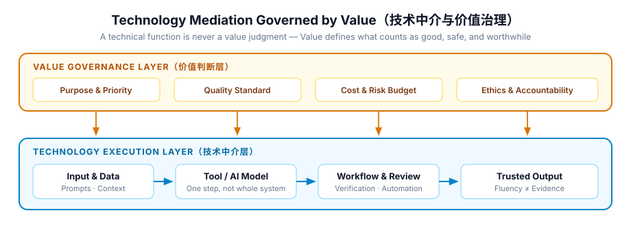

## Opening Problem

Why does a tool that promises clarity often create more confusion?

Technology is not just devices, apps, code, or AI. It is a domain of mediated action（被媒介化的行动）: tools extend what people can see, store, generate, automate, measure, and coordinate. Because technology changes the action surface, people often misread technical problems as personal problems, or personal judgment problems as technical problems.

This chapter teaches the reader to ask: what kind of technical object is this, and what does it actually do in the system?

::: {.callout-note title="Scope & Boundary"}
Technology in this book is not a programming textbook. It does not try to explain every architecture, framework, model, protocol, or product category. It gives a placement language for daily technical life: tool, software, AI model, data, system, platform, automation, and workflow.
:::

## Domain Language

Technology talks about the world through these questions:

- **Function**: What does it do?
- **Input**: What does it receive?
- **Output**: What does it produce?
- **Interface**: How does a person or another system interact with it?
- **Constraint**: What can it not do?
- **Automation**: Which steps happen without direct human action?
- **Dependency**: What does it rely on?
- **Failure mode**: How can it break, distort, or mislead?
- **Workflow**: Where does it sit in a sequence of action?

The key shift: do not ask only “Is this technology good?” Ask, “What position does it occupy in the action system?”

## Group Map

Technology has eight Groups:

1. **Tool（工具）**: an object or system used to extend action.
2. **Software（软件）**: application, interface, component, and programmable behavior.
3. **AI Model（AI 模型）**: model that generates, classifies, embeds, predicts, or transforms.
4. **Data（数据）**: structured or unstructured information used by tools and systems.
5. **System（系统）**: interacting parts that produce behavior.
6. **Technology Platform（技术平台）**: environment that hosts, exposes, governs, or distributes technical capability.
7. **Automation（自动化）**: repeatable execution without manual step-by-step control.
8. **Workflow（工作流）**: ordered use of tools, people, data, and decisions.

| Group | What It Names |
|---|---|
| **Tool（工具）** | an object or system used to extend action. |
| **Software（软件）** | application, interface, component, and programmable behavior. |
| **AI Model（AI 模型）** | model that generates, classifies, embeds, predicts, or transforms. |
| **Data（数据）** | structured or unstructured information used by tools and systems. |
| **System（系统）** | interacting parts that produce behavior. |
| **Technology Platform（技术平台）** | environment that hosts, exposes, governs, or distributes technical capability. |
| **Automation（自动化）** | repeatable execution without manual step-by-step control. |
| **Workflow（工作流）** | ordered use of tools, people, data, and decisions. |

## Core Containers

### Tool

Tool is the language of extended action. It asks what human capacity is being extended: memory, attention, speed, comparison, creation, coordination, or control.

A tool should be judged by fit. A powerful tool in the wrong workflow becomes friction with a nicer interface.

#### Cognitive Tool（认知工具）

**Primary position:** Technology → Tool → Cognitive Tool

**Cognitive Tool（认知工具）** helps a person think, compare, remember, reason, or structure attention.

**Common misplacement:** treating a cognitive tool as an authority. A tool can shape thinking without replacing judgment.

**Use sentence:** “This tool helps me think, but it does not decide what is true.”

#### Productivity Tool（效率工具）

**Primary position:** Technology → Tool → Productivity Tool

**Productivity Tool（效率工具）** helps manage tasks, time, documents, communication, or repeated operations.

**Common misreading:** assuming productivity tools create productivity. They often expose a workflow problem.

**Use sentence:** “The tool is not failing; the workflow may be undefined.”

#### Creative Tool（创作工具）

**Primary position:** Technology → Tool → Creative Tool

**Creative Tool（创作工具）** helps generate, edit, arrange, or transform expressive material.

**Common misplacement:** treating creative output as only tool output. Human taste, selection, and purpose still matter.

**Use sentence:** “The tool generated options; the creative judgment is in selection and direction.”

### Software

Software is the language of programmable behavior through interface and logic. It asks what task is supported, what state is stored, what action is allowed, and what path the user is guided through.

Software should not be read only as a product category. It is a designed environment for action.

#### Application（应用）

**Primary position:** Technology → Software → Application

**Application（应用）** is software designed around user tasks and interface flows.

**Common misreading:** treating app choice as workflow design.

**Use sentence:** “Choosing the app does not yet define the workflow.”

#### UI Component / Widget（界面组件）

**Primary position:** Technology → Software → UI Component / Widget

**UI Component / Widget（界面组件）** is a reusable interface element for interaction, display, input, or navigation.

**Common misplacement:** treating a component as decoration. Components shape user action.

**Use sentence:** “This widget changes what action becomes easy or visible.”

### AI Model

AI Model is the language of statistical transformation（统计转换）. It asks what the model receives, what it generates or predicts, what training or retrieval context shapes it, and what it cannot know.

AI model language is necessary because fluent output can hide weak grounding. The model may be useful even when it is not authoritative.

#### Language Model（语言模型）

**Primary position:** Technology → AI Model → Language Model

**Language Model（语言模型）** predicts and generates language-like output from context.

**Common misreading:** treating fluent output as grounded knowledge. Fluency（流畅性） is not the same as verification.

**Use sentence:** “The language model can draft the reasoning, but the claims still need grounding.”

#### Image Model（图像模型）

**Primary position:** Technology → AI Model → Image Model

**Image Model（图像模型）** generates or edits images from prompts, references, or latent patterns.

**Common misplacement:** using image generation where exact visual evidence is required.

**Use sentence:** “This image is a generated representation, not documentary evidence.”

#### Embedding Model（嵌入模型）

**Primary position:** Technology → AI Model → Embedding Model

**Embedding Model（嵌入模型）** converts text, images, or other data into vectors for similarity and retrieval.

**Common misreading:** thinking similarity equals meaning.

**Use sentence:** “The embedding found related material, but similarity still needs interpretation.”

### Data

Data is the language of representation（表征）. It asks what has been collected, selected, measured, structured, excluded, transformed, and interpreted.

Data should not be treated as raw reality. Every dataset carries choices about what counts and what disappears.

#### Dataset（数据集）

**Primary position:** Technology → Data → Dataset

**Dataset（数据集）** is a collection of data points organized for analysis, training, retrieval, or reference.

**Common misplacement:** treating a dataset as reality itself.

**Use sentence:** “The dataset represents reality through selection and measurement.”

#### Data Structure（数据结构）

**Primary position:** Technology → Data → Data Structure

**Data Structure（数据结构）** is an arrangement that makes data usable for certain operations.

**Common misreading:** treating structure as neutral. A structure makes some actions easy and others hard.

**Use sentence:** “The data structure shapes what the system can efficiently do.”

#### Data Pipeline（数据管道）

**Primary position:** Technology → Data → Data Pipeline

**Data Pipeline（数据管道）** moves and transforms data through stages.

**Common misplacement:** diagnosing output errors without checking pipeline stages.

**Use sentence:** “We need to locate where in the pipeline the distortion enters.”

### System

System is the language of interacting parts. It asks how components, state, rules, dependencies, interfaces, and feedback produce behavior that no single part fully explains.

System language prevents surface blame. What appears in the interface may be caused by storage, permission, network, backend logic, user input, or platform rules.

#### Backend System（后端系统）

**Primary position:** Technology → System → Backend System

**Backend System（后端系统）** handles storage, business logic, authentication, processing, and integration behind the visible interface.

**Common misreading:** blaming the interface for a backend constraint.

**Use sentence:** “The visible problem may come from backend state or permission logic.”

#### Frontend（前端）

**Primary position:** Technology → System → Frontend

**Frontend（前端）** is the user-facing layer where interface, state, layout, and interaction meet.

**Common misplacement:** treating frontend as surface only. Frontend is where system behavior becomes usable or confusing.

**Use sentence:** “The frontend is not decoration; it is the action surface.”

#### API（接口）

**Primary position:** Technology → System → API

**API（接口）** is a formal way for systems to communicate.

**Common misreading:** treating an API as a product experience.

**Use sentence:** “The API enables access, but the workflow still needs design.”

### Technology Platform

Technology Platform is the language of hosted capability and dependency. It asks who provides the environment, what rules govern access, what limits exist, and what lock-in or leverage is created.

A platform is never only technical. It combines infrastructure, policy, pricing, documentation, ecosystem, and power.

#### Cloud Platform（云平台）

**Primary position:** Technology → Technology Platform → Cloud Platform

**Cloud Platform（云平台）** provides hosted computation, storage, deployment, networking, and managed services.

**Common misplacement:** treating cloud as unlimited infrastructure.

**Use sentence:** “Cloud removes some local constraints but introduces cost, permission, and dependency constraints.”

#### API Platform（接口平台）

**Primary position:** Technology → Technology Platform → API Platform

**API Platform（接口平台）** exposes capabilities through APIs, documentation, pricing, limits, and policies.

**Common misreading:** assuming the platform is only technical. It is technical + economic + social rule.

**Use sentence:** “The API platform defines both capability and dependency.”

#### Dev Platform（开发平台）

**Primary position:** Technology → Technology Platform → Dev Platform

**Dev Platform（开发平台）** supports building, testing, deploying, distributing, or maintaining software.

**Common misplacement:** blaming developer skill when the platform experience is poorly designed.

**Use sentence:** “The friction may be platform ergonomics, not only developer ability.”

### Automation

Automation is the language of repeated execution. It asks which steps happen without manual control, what triggers them, what assumptions they encode, and how failure is detected.

Automation makes a process faster and more consistent. It does not make the process wiser.

#### Pipeline（流水线）

**Primary position:** Technology → Automation → Pipeline

**Pipeline（流水线）** is an automated or semi-automated sequence of build, test, transform, deploy, or data steps.

**Common misreading:** treating a pipeline as reliable because it is automated.

**Use sentence:** “Automation repeats a process; it does not guarantee the process is correct.”

#### Script（脚本）

**Primary position:** Technology → Automation → Script

**Script（脚本）** is a small program that performs a defined task or sequence.

**Common misplacement:** turning every script into an invisible dependency.

**Use sentence:** “If the script becomes essential, it needs documentation and failure handling.”

#### Rule-based Automation（规则自动化）

**Primary position:** Technology → Automation → Rule-based Automation

**Rule-based Automation（规则自动化）** executes actions when defined conditions are met.

**Common misreading:** confusing rule-based behavior with intelligence.

**Use sentence:** “This automation follows rules; it does not understand exceptions unless we encode them.”

### Workflow

Workflow is the language of ordered action. It asks where people, tools, models, data, review, storage, and judgment sit in a sequence.

Workflow is often the missing layer in technical thinking. A model can be impressive while the surrounding workflow remains fragile.

#### AI Workflow（AI 工作流）

**Primary position:** Technology → Workflow → AI Workflow

**AI Workflow（AI 工作流）** places AI models inside a sequence of human and machine actions.

**Common misplacement:** treating the model as the whole workflow.

**Use sentence:** “The model is one step; the workflow includes input, review, storage, and use.”

#### Manual Workflow（手动工作流）

**Primary position:** Technology → Workflow → Manual Workflow

**Manual Workflow（手动工作流）** relies mainly on human actions, judgment, and handoffs.

**Common misreading:** assuming manual means primitive. Manual can be appropriate when stakes, ambiguity, or judgment are high.

**Use sentence:** “Manual review stays because the risk is judgment-heavy.”

#### Hybrid Workflow（混合工作流）

**Primary position:** Technology → Workflow → Hybrid Workflow

**Hybrid Workflow（混合工作流）** combines automation and human judgment.

**Common misplacement:** unclear responsibility between human and system.

**Use sentence:** “The hybrid workflow must state which decisions are automated and which remain human.”

## Misplacement Patterns

| Often Confused / Misplaced As | Distinct Reality / Better Placement | Why It Matters |
|---|---|---|
| Tool | Authority | treating a tool output as truth. |
| Model | Workflow | thinking an AI model alone solves the process. |
| Automation | Correctness | assuming repeated execution means valid execution. |
| Dataset | Reality | forgetting selection, measurement, and bias. |
| Interface | System | blaming what is visible without tracing hidden dependencies. |
| Platform | Neutral environment | ignoring rules, pricing, lock-in, and incentives. |

::: {.content-visible when-format="html"}

:::

## Causal Chain

A technology problem often follows this chain:

1. A tool is introduced.
2. Its real position in the workflow is not named.
3. Users expect it to solve a different problem.
4. Outputs are trusted or rejected for the wrong reason.
5. The system creates new errors, hidden work, or dependency.

Better chain:

1. Name the technical object.
2. Locate its inputs, outputs, interface, dependencies, and failure modes.
3. Place it inside a workflow.
4. Define what remains human judgment.

::: {.content-visible when-format="html"}

:::

## Placement Practice

| Case / Statement | Suggested Placement |
|---|---|
| “AI wrote a fluent answer, so it must know.” | AI Model → Language Model + Value → Evidence. |
| “The app is bad because my team still misses tasks.” | Productivity Tool + Workflow + Work → Recurring Task. |
| “The dashboard number is wrong.” | Data Pipeline before visual interface blame. |
| “This automation saved time but caused mistakes.” | Automation → Pipeline + Value → Risk. |
| “The platform changed the rules and our product broke.” | Technology Platform + Society → Platform Rule. |

## Chapter Output

Technology becomes usable when it is placed. The useful question is:

> What technical object is this, where does it sit in the workflow, and what judgment must remain outside it?
