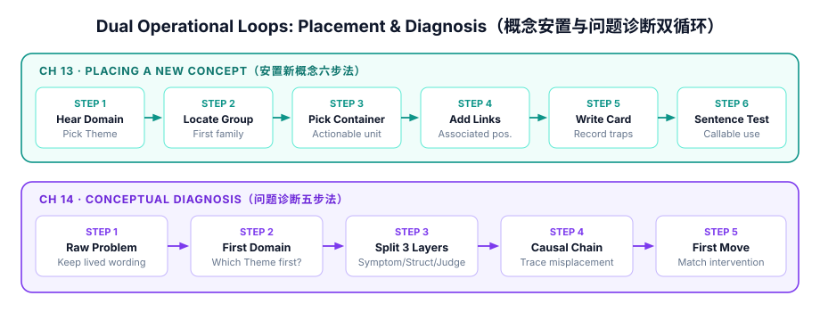

## Opening Problem

What should the reader do when a new concept appears?

Most people react to a new concept by trying to understand its definition immediately. That is useful, but incomplete. A concept becomes readable only after the reader knows what kind of world it belongs to. The first question is not “What does this word mean?” The first question is:

> Where does this concept speak from?

This chapter turns the eight Theme Toolboxes into a placement method.



## Step 1: Hear the Domain Language

Before defining a concept, listen to the kind of language around it.

- If the text talks about sleep, pain, energy, breathing, fatigue, or sensation, begin with **Body**.
- If it talks about attention, emotion, memory, belief, bias, or decision, begin with **Mind**.
- If it talks about terms, claims, definitions, arguments, prompts, or documents, begin with **Language**.
- If it talks about tasks, projects, skills, feedback, workflow, or output, begin with **Work**.
- If it talks about trust, boundary, intimacy, conflict, or roles between people, begin with **Relationship**.
- If it talks about institutions, markets, rules, organizations, or platforms, begin with **Society**.
- If it talks about tools, software, data, models, systems, or automation, begin with **Technology**.
- If it talks about cost, risk, purpose, standards, ethics, or meaning, begin with **Value**.

This first placement does not need to be perfect. It only needs to stop the concept from floating.

## Step 2: Locate the Group

After choosing a Theme, ask which Group is active. A Group is the concept’s first neighborhood（第一邻域）.

For example:

- “Burnout” may begin in Body → Energy and Mind → Emotional Regulation.
- “Prompt” belongs first to Language → Instruction, with a link to Technology → AI Workflow.
- “Salary” may belong to Society → Market and Value → Benefit.
- “Boundary” belongs to Relationship → Boundary, with links to Body, Mind, Language, Work, and Value → Ethics.

If one concept seems to belong everywhere, do not panic. Choose the primary position first, then write the associated positions separately.

## Step 3: Choose the Container

A Container is the level where the concept becomes actionable. It is specific enough to guide use, but general enough to hold many examples.

Use these questions:

- What problem does this concept help solve?
- What mistaken concept is it often confused with?
- What action does it make possible?
- What sentence can I say with it?

Example:

Concept: “Opportunity cost.”

- Theme: Value.
- Group: Cost.
- Container: Opportunity Cost.
- Problem solved: it shows what is lost by choosing one path.
- Common misplacement: only counting money.
- Use sentence: “The real cost includes the option I cannot pursue.”

## Step 4: Add Associated Positions

Many strong concepts have one primary position and several associated positions（关联位置）.

For example:

- “Sleep” begins in Body, but affects Mind, Work, Relationship, and Value.
- “AI workflow” begins in Technology, but links to Language, Work, and Value.
- “Trust repair” begins in Relationship, but uses Language and requires Value.
- “Career path” begins in Society, but links to Work, Value, and Mind → Self.

The rule is:

> Primary position tells the reader what the concept is. Associated positions tell the reader what the concept touches.

## Step 5: Write a Placement Card

Use this short card:

```text
Concept:
Primary Theme:
Group:
Container:
Problem it helps solve:
Common misplacement:
Common misreading:
Associated positions:
Use sentence:
One real example:
```

This card turns reading into a repeatable practice. It also prevents the book from becoming an encyclopedia.

## Step 6: Test With a Sentence

A concept is placed well when it can produce a clear sentence.

Weak placement:

> “Motivation is important.”

Better placement:

> “Motivation belongs first to Mind because it describes action readiness（行动准备度）, but it must be linked to Work when I design tasks and to Value when I decide whether the action matters.”

The better sentence is longer because it carries position, function, and connection.

::: {.content-visible when-format="html"}
<div data-ru-toy="ch13-six-step-placer"></div>
:::

## Placement Errors

Common errors include:

- placing everything under Mind because it is felt internally;
- placing everything under Value because it seems important;
- placing a social structure as personal weakness;
- placing a technical workflow as a tool problem;
- placing a language problem as intelligence;
- placing a body signal as laziness;
- placing relational boundary as rejection.

The cure is not more information. The cure is better position.

::: {.content-visible when-format="html"}
<div data-ru-toy="ch13-placement-error-audit"></div>
:::

## Chapter Output

After this chapter, the reader should be able to take a new concept and produce a placement card. The minimum output is:

> This concept belongs first to ___, under ___, inside ___, because it helps me understand ___.
