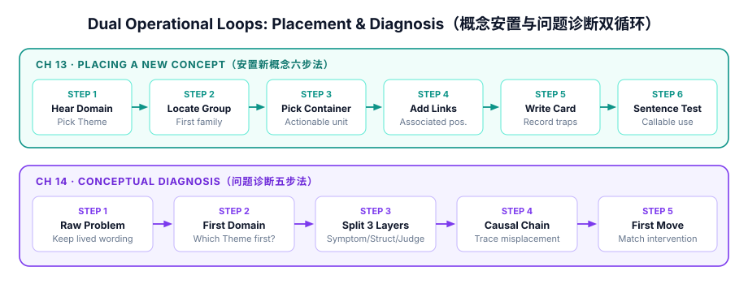

## Opening Problem

How can the RU Tree help when the reader is not learning a concept, but facing a messy problem?

A real problem rarely arrives as a clean concept. It arrives as fatigue, confusion, conflict, procrastination, money pressure, social comparison, tool failure, or moral discomfort. The RU Tree is useful because it lets the reader separate a knot（结） into positions.

Diagnosis here does not mean medical diagnosis or clinical diagnosis. It means conceptual diagnosis（概念性诊断）: locating what kind of problem this is before acting.

## The Diagnostic Question

Start with one sentence:

> What is being misplaced?

This question is stronger than “What should I do?” because action taken from the wrong placement usually repeats the problem.



## Step 1: Write the Raw Problem

Write the problem in ordinary language.

Examples:

- “I cannot focus.”
- “This project is not moving.”
- “I feel used in this relationship.”
- “My work is invisible.”
- “AI helps me produce more, but I do not know if the result is good.”

Do not polish the sentence too early. The raw sentence preserves the lived problem.

## Step 2: Identify the First Domain

Ask which Theme speaks first.

- “I cannot focus” may begin with Body or Mind.
- “This project is not moving” may begin with Work.
- “I feel used” may begin with Relationship.
- “My work is invisible” may begin with Society or Work.
- “AI helps me produce more, but I do not know if the result is good” may begin with Technology and Value.

The first domain is not the whole diagnosis. It is the first handle（第一个抓手）.

## Step 3: Separate Symptoms, Structure, and Judgment

Many problems mix three layers:

- **Symptom（症状/表现）**: what is felt or observed.
- **Structure（结构）**: what arrangement produces it.
- **Judgment（判断）**: what value meaning is attached to it.

Example:

Raw problem: “I am lazy.”

Possible separation:

- Symptom: low energy, avoidance, slow start.
- Structure: unclear task, no feedback loop, poor sleep.
- Judgment: “If I struggle, I am weak.”

The diagnosis may involve Body, Work, Mind, and Value. Calling it only “lazy” collapses the structure.

::: {.content-visible when-format="html"}
<div data-ru-toy="ch14-three-layer-splitter"></div>
:::

## Step 4: Trace the Causal Chain

Use a short causal chain:

```text
Because ___,
I experience ___,
so I interpret it as ___,
then I do ___,
which produces ___.
```

Example:

Because my task has no concrete next step, I experience friction, so I interpret it as lack of discipline, then I avoid the project, which produces more shame.

Placement:

- Work → Single Action Task.
- Mind → Emotional Regulation.
- Value → Standard / Meaning.

## Step 5: Choose the First Intervention

An intervention（干预） should match the primary placement.

- Body problem: change recovery, load, sleep, nutrition, movement, or medical support when needed.
- Mind problem: change attention, emotion regulation, belief, interpretation, or support.
- Language problem: define terms, rewrite claims, ask clarifying questions.
- Work problem: define task, workflow, milestone, feedback, or artifact.
- Relationship problem: clarify boundary, trust, role, expectation, or repair.
- Society problem: locate rule, market, institution, role, platform, or group.
- Technology problem: inspect input, output, interface, dependency, or workflow.
- Value problem: clarify priority, cost, risk, standard, ethics, or meaning.

Do not use one intervention for every problem. Meditation cannot solve every workflow. A new app cannot solve every value conflict. A conversation cannot solve every institution. More effort cannot solve every body signal.

::: {.content-visible when-format="html"}
<div data-ru-toy="ch14-causal-chain-debugger"></div>
:::

## Diagnostic Examples

### Example 1: “I cannot focus”

Possible placements:

- Body → Energy / Sleep.
- Mind → Attention Control.
- Work → Task Definition.
- Technology → Tool Distraction.
- Value → Purpose.

First diagnostic move: check whether the body has enough energy and the task has a clear next action before judging character.

### Example 2: “This relationship feels unequal”

Possible placements:

- Relationship → Boundary.
- Relationship → Cooperation.
- Relationship → Relational Role.
- Value → Fairness.
- Language → Statement / Clarifying Question.

First diagnostic move: name what is unequal: time, care, money, attention, decision power, emotional labor, or responsibility.

### Example 3: “The team is busy but nothing ships”

Possible placements:

- Work → Process Goal vs Outcome Goal.
- Work → Milestone.
- Language → Definition of done.
- Technology → Workflow.
- Society → Organization / Role.

First diagnostic move: define the artifact, milestone, and acceptance criteria.

### Example 4: “I am afraid AI will make my work meaningless”

Possible placements:

- Technology → AI Model / Workflow.
- Work → Skill.
- Society → Labor Market.
- Value → Meaning / Risk.
- Mind → Uncertainty.

First diagnostic move: separate market risk from personal meaning. They are related, but not identical.

## Chapter Output

The diagnostic output is a short map:

```text
Raw problem:
Primary placement:
Secondary placements:
Misplacement risk:
Causal chain:
First intervention:
```

The reader does not need to solve everything at once. The first win is to stop solving the wrong problem.
