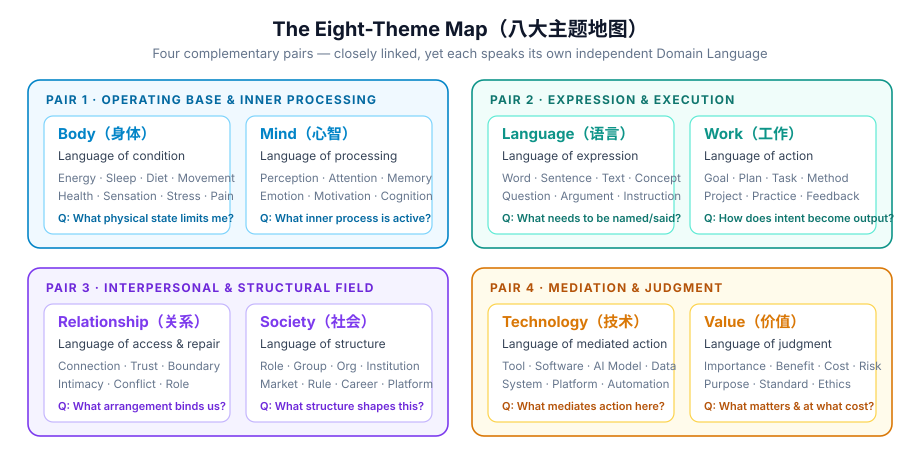

This is a book about **concept placement（概念安置）**.

Every day you meet concepts: attention, cognitive load, opportunity cost, feedback, boundary, trust, workflow, risk, meaning. You may recognize the words, but recognition is not use. A concept becomes useful only when it has a place: where it belongs, what it is near, what it is not, and what kind of sentence it helps you say.

This book builds a personal **RU Tree**.

RU means **Referable Unit（可指称单位）**: anything you can point to as "one thing" for thinking, speaking, classifying, and action. The RU Tree is not an encyclopedia, a school subject map, or a decorative mind map. It is a personal runtime structure（个人运行结构） for making concepts callable.

> Reading grows from understanding how a domain talks about the world. When the domain is understood, the reader can focus on what the text says rather than struggling to understand what the text is about. When the language is familiar, the reader can follow arguments through their full causal chains without pausing to decode individual terms.

## How This Book Is Organized

- **Part 1: Method and Map** builds the core method: Subject Gain, RU, the four-layer structure, and the eight-theme map.
- **Part 2: Body and Mind** places concepts of physical condition and inner processing.
- **Part 3: Language and Work** places concepts of expression, reasoning, action, and feedback.
- **Part 4: Relationship and Society** places interpersonal arrangements and social-structural forces.
- **Part 5: Technology and Value** places tools, systems, judgment, cost, risk, ethics, and meaning.
- **Part 6: Use and Training** turns the tree into a daily method for placing, diagnosing, maintaining, and revising concepts.
- **Appendices** provide the Master RU Tree Table, Concept Placement Card, Daily Training drills, and the Stress Test.

::: {.callout-tip title="How to Read & Use the Interactive Labs"}
The main text is written in English, with Chinese parenthetical anchors（中文括号说明） where they lower decoding friction. Every chapter in the HTML edition also includes **hands-on browser labs** for screening concepts, tracing causal chains, detecting misplacements, and practicing callable sentences.

Read **Part 1** first if you are new to the system. After that, move by need: **Body** when your system is tired, **Mind** when attention and emotion are unstable, **Language** when thought will not become clear speech, **Work** when effort fails to become progress, **Relationship** when access and trust are confused, **Society** when personal problems reveal social positions, **Technology** when tools reshape action, and **Value** when you need to decide what matters.
:::

> **The promise of the book is simple:** When a concept has a place, it can be called, tested, connected, and used.
